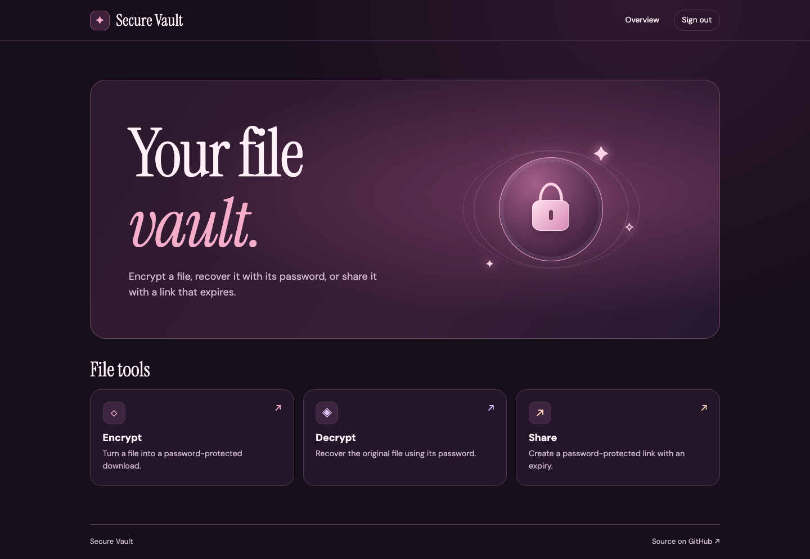

# Secure Vault

Secure Vault is a Flask portfolio project for password-based file encryption and expiring file shares. Encrypt a file, download the encrypted copy, and recover the original with the same password. Or create a link that lets someone download a file after entering a share password.



## Quick start

Use Python 3.12.

```sh
git clone https://github.com/bunnybunss/secure-vault.git
cd secure-vault
python3 -m venv .venv
source .venv/bin/activate
python -m pip install -r requirements.txt
python init_db.py
python app.py
```

Open [Secure Vault locally](http://127.0.0.1:5000). Create a demo account and use a file with dummy data.

1. **Encrypt.** Upload a sample file, enter a file password, and download the `.enc` file.
2. **Decrypt.** Upload the `.enc` file and enter the same password to download the recovered file. Try a wrong password to see the error.
3. **Share.** Upload a sample file, choose a share password and a lifetime in minutes, then open the generated link in a private browser window and enter the share password.

## How it works

| Feature | Implementation |
| --- | --- |
| Accounts | Flask and SQLite store account records with hashed passwords. JWTs authenticate uploads. |
| Encryption | AES-256-GCM authenticates ciphertext. Each new encryption uses a random 16-byte salt and a random 12-byte nonce. PBKDF2-HMAC-SHA-256 derives the key using 600,000 iterations. |
| Downloads | Encrypt and decrypt return files directly to the authenticated browser with `Cache-Control: no-store`. The app does not write these outputs to disk. |
| Sharing | The server stores the encrypted file and verifies the share password and expiration before decrypting it. The recipient needs the link and password. |
| File format | New files contain a version marker, salt, nonce, ciphertext, and authentication tag. Decryption also supports files produced by the original prototype. |

## Run the tests

```sh
python -m unittest discover -s tests -v
```

The tests use temporary SQLite databases and synthetic files. They cover account login, protected uploads, byte-for-byte recovery, randomized encryption, incorrect passwords, modified ciphertext, legacy decryption, and expired shares.

## Scope and limitations

Secure Vault is a local prototype. Use dummy files and unique demo passwords. Encryption happens on the server, which sees uploaded plaintext and passwords during requests. The app buffers uploads in memory and caps requests at 16 MiB. Expiration blocks downloads, but encrypted files and share metadata remain on disk until removed. A public deployment would also need HTTPS, rate limiting, storage quotas, scheduled cleanup, and a security review.
